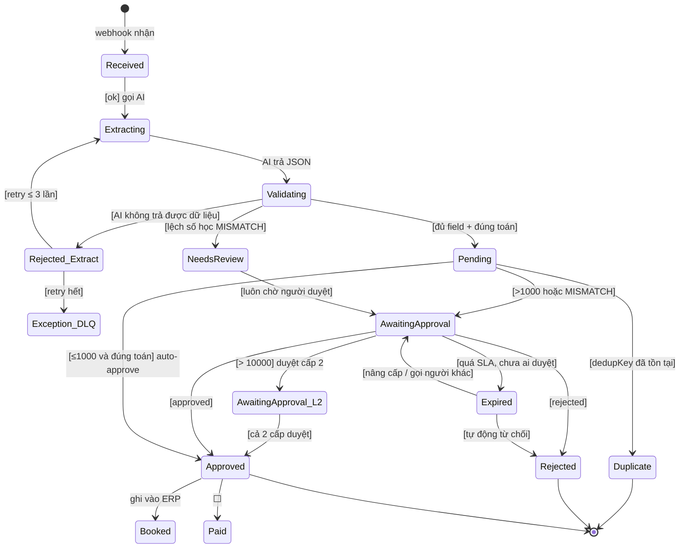

# Business Specification — Invoice Processing

> Tài liệu này mô tả **toàn bộ nghiệp vụ và tính năng** của hệ thống xử lý hóa đơn.
> Nó là **bản thiết kế mục tiêu**, không phải trạng thái hiện tại.
>
> - ✅ **ĐÃ CÓ** — đã implement và đã test
> - 🟡 **MỘT PHẦN** — có nhưng chỉ ở mức tối thiểu
> - ⬜ **DỰ KIẾN** — chưa làm, ghi ở đây để giữ hướng thiết kế
>
> Trạng thái implement thực tế luôn lấy **[README.md](README.md)** làm chuẩn.

---

## 1. Phạm vi & vai trò

### 1.1 Vai trò (actors)

| Vai trò | Làm gì | Trong hệ thống |
|---|---|---|
| **Người gửi** (client) | Gửi nội dung hóa đơn qua webhook | POST `/webhook/invoice-incoming` |
| **AP Clerk** | Nhập liệu, xử lý hóa đơn lỗi/lệch | Đọc sheet `Needs Review` / `Exception` |
| **Approver** | Duyệt/từ chối hóa đơn vượt ngưỡng | Bấm approve trên Slack |
| **Finance Manager** | Duyệt cấp 2, duyệt theo hạn mức lớn | ⬜ chưa có (approval 1 cấp) |
| **Auditor** | Kiểm tra ai duyệt gì, khi nào | 🟡 chỉ có log execution, chưa có cột audit |
| **System** | Toàn bộ tự động hóa | n8n workflow |

### 1.2 Phạm vi

**TRONG phạm vi:** nhận hóa đơn (dạng text) → AI trích xuất → validate → ghi sổ → thông báo → duyệt (nếu cần) → cập nhật trạng thái.

**NGOÀI phạm vi (ghi nhận để sau):** nhận PDF/ảnh qua upload, OCR ảnh, đối soạn với PO/ERP, thanh toán, tích hợp phần mềm kế toán, xuất báo cáo thuế.

---

## 2. Vòng đời hóa đơn (trạng thái)

### 2.1 Sơ đồ trạng thái mở rộng



### 2.2 Bảng trạng thái

| Trạng thái | Nghĩa | Ai set | Trạng thái |
|---|---|---|---|
| `Received` | Đã nhận, chưa xử lý | webhook | ⬜ (ngầm, chưa có cột) |
| `Extracting` | Đang gọi AI | — | ⬜ |
| `Pending` | Hợp lệ, chờ duyệt hoặc chờ auto-approve | Validate | ✅ |
| `Needs Review` | Lệch số học, chờ người xem | Validate | ✅ |
| `Duplicate` | Trùng `dedupKey`, bỏ qua | — | 🟡 (upsert, không có trạng thái riêng) |
| `Awaiting Approval` | Chờ duyệt | Router | ✅ |
| `Awaiting Approval L2` | Chờ duyệt cấp 2 | Router | ⬜ |
| `Approved` | Đã duyệt | Approver / auto | ✅ |
| `Rejected` | Bị từ chối | Approver | ✅ |
| `Expired` | Quá SLA không ai duyệt | Wait node | 🟡 (timeout xử lý, chưa đánh dấu) |
| `Booked` / `Paid` | Đã ghi ERP / đã trả | — | ⬜ |
| `Exception_DLQ` | Rơi vào hàng đợi lỗi | Error workflow | ⬜ |

---

## 3. Nghiệp vụ thu hóa đơn (Intake)

| Mã | Quy tắc | Trạng thái |
|---|---|---|
| IN-01 | Hệ thống chỉ nhận JSON qua `POST /webhook/invoice-incoming`, `httpMethod: POST` | ✅ |
| IN-02 | Bắt buộc header `x-invoice-key` (xác thực), thiếu → **403** | ✅ |
| IN-03 | Payload: `{ invoiceText: string, fileName: string }` | ✅ |
| IN-04 | `invoiceText` rỗng → đi thẳng exception, không gọi AI | ⬜ |
| IN-05 | Giới hạn kích thước `invoiceText` (vd 100KB) → 413 nếu vượt | ⬜ |
| IN-06 | Webhook trả lời ngay (`responseMode: onReceived`), xử lý bất đồng bộ | ✅ |
| IN-07 | Nhận PDF/ảnh + OCR bóc tách | ⬜ |
| IN-08 | Xác thực chữ ký số trên hóa đơn điện tử | ⬜ |
| IN-09 | Giới hạn tần suất theo IP/API key (rate limit) | ⬜ |

---

## 4. Nghiệp vụ trích xuất (AI)

| Mã | Quy tắc | Trạng thái |
|---|---|---|
| EX-01 | Gọi Google Gemini `:generateContent`, `responseMimeType: application/json` | ✅ |
| EX-02 | Model mặc định `gemini-3.5-flash-lite`, có `retryOnFail` ×5 (chịu lỗi 503 tạm thời) | ✅ |
| EX-03 | Prompt yêu cầu đúng 13 keys (12 field + `lineItems`), null cho field thiếu | ✅ |
| EX-04 | Bóc tách prompt JSON trong ```json fence | ✅ |
| EX-05 | AI trả JSON không parse được → throw → exception | ✅ |
| EX-06 | Mỗi field trả kèm **độ tin cậy** (confidence 0–1) | ⬜ |
| EX-07 | Field nào confidence < ngưỡng (vd 0.8) → đánh dấu cần người xác nhận | ⬜ |
| EX-08 | Chạy 2 model rồi đối chiếu (cross-check) khi confidence thấp | ⬜ |
| EX-09 | Che mask thông tin nhạy cảm trước khi gửi AI (số tài khoản, CMND) | ⬜ |
| EX-10 | Log usage token/cost mỗi lần gọi | ⬜ |

Danh sách field trích xuất:

```
vendor · billTo · invoiceNumber · invoiceDate · dueDate · poNumber
paymentTerms · currency · subtotal · taxRate · taxAmount · totalAmount
lineItems[] { description, quantity, unitPrice, amount }
```

---

## 5. Nghiệp vụ kiểm tra (Validation)

### 5.1 Kiểm tra bắt buộc (reject → exception)

| Mã | Quy tắc | Trạng thái |
|---|---|---|
| VA-01 | `vendor`, `billTo`, `invoiceNumber` phải là text không rỗng | ✅ |
| VA-02 | Field không được là object/array | ✅ |
| VA-03 | `totalAmount` phải parse được thành số (chấp nhận `12,500.00`, `12.500,00`, `USD 1250`, `(500)`) | ✅ |
| VA-04 | `totalAmount` phải **> 0** | ✅ |
| VA-05 | `currency` phải là ISO-4217 3 chữ cái | ✅ |
| VA-06 | `lineItems` nếu có thì phải là array | ✅ |
| VA-07 | JSON từ AI phải parse được | ✅ |

### 5.2 Kiểm tra nhất quán (flag → `Needs Review`)

| Mã | Quy tắc | Trạng thái |
|---|---|---|
| VS-01 | `calcSubtotal = Σ lineItems.amount` | 🟡 có tính, chưa đối chiếu |
| VS-02 | `calcTotal = subtotal + taxAmount`, `mathCheck = OK` nếu `\|calcTotal − totalAmount\| < 0.05` | ✅ |
| VS-03 | `calcSubtotal == subtotal` lệch quá ngưỡng → MISMATCH | ⬜ |
| VS-04 | `taxAmount ≈ subtotal × taxRate / 100` | ⬜ |
| VS-05 | `invoiceDate` không ở tương lai (> today) | ⬜ |
| VS-06 | `dueDate >= invoiceDate` | ⬜ |
| VS-07 | `currency` nằm trong danh sách cho phép | 🟡 (chỉ check format) |
| VS-08 | `poNumber` đúng format (vd `PO-\d{4}`) | ⬜ |
| VS-09 | Hóa đơn cùng `billTo` + `invoiceNumber` chưa tồn tại trong 30 ngày | ⬜ |

### 5.3 Chuẩn hóa

| Mã | Quy tắc | Trạng thái |
|---|---|---|
| VN-01 | Text bị cắt/xén khoảng trắng, gộp space liền nhau | ✅ |
| VR-02 | `dedupKey = VENDOR \| INVOICE_NUMBER` (viết hoa) | ✅ |
| VN-03 | Ngày chuẩn hóa về `YYYY-MM-DD` | ⬜ |
| VN-04 | Số tiền làm tròn 2 chữ số thập phân | ⬜ |
| VN-05 | Tên vendor map về mã vendor chuẩn (vendor master) | ⬜ |

---

## 6. Nghiệp vụ phân loại & định tuyến

### 6.1 Ma trận định tuyến

| Điều kiện | Hành động | Trạng thái |
|---|---|---|
| `totalAmount <= 1000` **và** `mathCheck = OK` | **Tự động duyệt** → Status `Approved` | ✅ |
| `totalAmount > 1000` | Chờ duyệt (Slack) | ✅ |
| `mathCheck != OK` | Chờ duyệt + Status `Needs Review` | ✅ |
| `dedupKey` đã tồn tại | **Upsert** — cập nhật dòng cũ, không tạo mới | ✅ |
| Bất kỳ node fail | Error workflow → Slack | ✅ |
| `totalAmount > 10.000` | Duyệt cấp 2 bắt buộc | ⬜ |
| Vendor trong blacklist | Chặn + cảnh báo | ⬜ |
| Ngoại tệ ≠ USD | Quy đổi ra USD theo tỷ giá ngày rồi mới so ngưỡng | ⬜ |

### 6.2 Đa tiền tệ — vấn đề chưa giải quyết

Ngưỡng `1000` hiện so trực tiếp trên số tiền **bất kể tiền tệ**:
- `500.000 VND` (~$20) → đi nhánh duyệt (thừa)
- `900 EUR` (~$970) → tự động duyệt (thiếu kiểm soát)

**Dự kiến:** quy đổi về USD bằng tỷ giá ngày (hoặc base currency công ty) trước khi so ngưỡng.

---

## 7. Nghiệp vụ ghi sổ (Ledger)

| Mã | Quy tắc | Trạng thái |
|---|---|---|
| LD-01 | Ghi vào Google Sheets, 15 cột (14 nghiệp vụ + `Dedup Key`) | ✅ |
| LD-02 | Dùng `appendOrUpdate` theo `Dedup Key` — idempotent | ✅ |
| LD-03 | Gửi lại cùng hóa đơn → cập nhật dòng cũ, không nhân đôi | ✅ |
| LD-04 | `Dedup Key` = khoá nghiệp vụ thật (vendor + invoiceNumber) | ✅ |
| LD-05 | Sheet phải có đủ 15 cột đúng tên | ✅ |
| LD-06 | Service account cần quyền **Editor** | ✅ |
| LD-07 | Mỗi lần thay đổi trạng thái ghi 1 dòng lịch sử (append-only audit log) | ⬜ |
| LD-08 | Khóa dòng đã `Approved` trước khi sửa | ⬜ |
| LD-09 | Chuyển sổ sang database khi > ~10.000 dòng (Sheets chậm) | ⬜ |

---

## 8. Nghiệp vụ duyệt (Approval)

### 8.1 Ma trận phân cấp duyệt (dự kiến)

| Giá trị (USD) | Cấp duyệt | SLA | Trạng thái |
|---|---|---|---|
| ≤ 1.000 và đúng toán | Không cần — tự động | — | ✅ |
| 1.000 – 10.000 | Cấp 1 (Manager) | 2 ngày làm việc | 🟡 có 1 cấp, chưa có SLA theo vai trò |
| 10.000 – 50.000 | Cấp 1 + Cấp 2 (Director) | 3 ngày | ⬜ |
| > 50.000 | Thêm Cấp 3 (CFO) | 5 ngày | ⬜ |
| Bất kỳ, `MISMATCH` | Bắt buộc người xem | 2 ngày | ✅ (1 cấp) |

### 8.2 Quy tắc duyệt

| Mã | Quy tắc | Trạng thái |
|---|---|---|
| AP-01 | Yêu cầu duyệt gửi qua Slack kèm link resume URL động | ✅ |
| AP-02 | Resume URL chỉ chấp nhận `POST` | ✅ |
| AP-03 | URL resume ký bằng `signature`, không đoán được | ✅ |
| AP-04 | Chờ tối đa **7 ngày** (`limitWaitTime`); quá → execution kết thúc | ✅ |
| AP-05 | Payload duyệt: `{ dedupKey, status, approvedBy, comment }` | 🟡 (gợi ý trong message, chưa validate) |
| AP-06 | Ai có link đều duyệt được (không kiểm tra danh tính) | ⬜ cần siết |
| AP-07 | Ghi nhận **ai** duyệt, **khi nào**, **vì sao** vào sheet | ⬜ |
| AP-08 | Tính lại `Dedup Key` + `status` từ payload để cập nhật đúng dòng | ✅ |
| AP-09 | Duyệt ủy quyền (delegation) khi người duyệt vắng | ⬜ |
| AP-10 | Tự động nhắc (reminder) sau 24h/48h chưa duyệt | ⬜ |
| AP-11 | Leo thang (escalation): quá SLA → gửi cấp trên | ⬜ |
| AP-12 | Từ chối kèm lý do bắt buộc | ⬜ |
| AP-13 | Duyệt qua Slack button (`sendAndWait`) thay vì POST tay | ⬜ |
| AP-14 | Phê duyệt sau khi đã duyệt → chặn (không cho sửa) | ⬜ |

---

## 9. Nghiệp vụ thông báo

| Mã | Sự kiện | Kênh | Trạng thái |
|---|---|---|---|
| NT-01 | Hóa đơn mới đã ghi sổ | Slack | ✅ |
| NT-02 | Cần duyệt (cao giá trị / lệch toán) | Slack | ✅ |
| NT-03 | Bất kỳ node fail | Slack + DLQ `Exceptions`, kèm severity + route | ✅ |
| NT-04 | Trùng hóa đơn (bỏ qua) | — | ⬜ |
| NT-05 | Nhắc duyệt quá 24h | Slack | ⬜ |
| NT-06 | Leo thang lên cấp trên | Slack/Email | ⬜ |
| NT-07 | Báo cáo ngày tồn đọng | Email/Sheets | ⬜ |

Nội dung message duyệt nên có: mã HĐ, vendor, khách, số tiền + tiền tệ, `mathCheck`, `dedupKey`, link duyệt, hạn duyệt, người được hỏi.

---

## 10. Nghiệp vụ ngoại lệ (Exception)

### 10.1 Phân loại lỗi

| Loại | Ví dụ | Cách xử lý | Trạng thái |
|---|---|---|---|
| **Transient** | 429, 5xx, timeout mạng | Retry có backoff (3 lần, 2s) | ✅ (Sheets/Slack) |
| **Config** | Thiếu credential, sai quyền Sheets | Sửa config, báo ngay | 🟡 chỉ báo Slack |
| **Dữ liệu** | Thiếu field, sai số, lệch toán | Vào `Needs Review` / DLQ, người xem | 🟡 |
| **Trùng** | `dedupKey` đã có | Upsert, không nhân đôi | ✅ |
| **Nghiệp vụ** | Vendor blacklist, quá hạn PO | Chặn + cảnh báo | ⬜ |
| **Hệ thống** | n8n restart, wait hết hạn | Cảnh báo + kiểm tra lại | ⬜ |

### 10.2 Dead Letter Queue

| Mã | Quy tắc | Trạng thái |
|---|---|---|
| EX-01 | Lỗi được lưu vào tab `Exceptions` (Exception ID, timestamp, node, category, lỗi, URL execution) | ✅ |
| EX-02 | Tab `Exceptions` riêng, ghi bằng `appendOrUpdate` (khoá `Exception ID`) | ✅ |
| EX-03 | Cho phép **replay** gói lỗi sau khi sửa nguyên nhân | 🟡 có record đệ lại, chưa có nút replay |
| EX-04 | Đếm số lần retry, chặn sau N lần | ⬜ |
| EX-05 | Lỗi lặp lại > N lần/ngày → cảnh báo | ⬜ |

> Đã có DLQ (tab `Exceptions`) — mỗi lỗi đều có dấu vết bền vững kèm link execution để mở lại. Chưa có cơ chế replay tự động (vẫn phải gửi lại tay).

---

## 11. Bảo mật, kiểm toán, tuân thủ

| Mã | Hạng mục | Trạng thái |
|---|---|---|
| SEC-01 | Webhook yêu cầu `x-invoice-key` | ✅ |
| SEC-02 | Credential lưu trong n8n, không ở repo | ✅ |
| SEC-03 | Resume URL có chữ ký | ✅ |
| SEC-04 | Ai có link duyệt đều duyệt được — **lỗ hổng** | ⬜ cần xác thực danh tính |
| SEC-05 | Không kiểm tra danh tính approver | ⬜ |
| SEC-06 | Service account chỉ có quyền đúng 1 sheet | 🟡 |
| AU-01 | Mọi execution có log đầy đủ node + input/output | ✅ |
| AU-02 | Ghi **ai** duyệt, **khi nào**, **vì sao** | ⬜ |
| AU-03 | Append-only audit log mỗi lần đổi trạng thái | ⬜ |
| AU-04 | Xuất được lịch sử 1 hóa đơn theo timeline | ⬜ |
| CMP-01 | **PII gửi lên Gemini** — vendor/khách/PO/số tiền rời hệ thống | 🟡 đã ghi nhận, chưa xử lý |
| CMP-02 | Mask dữ liệu nhạy cảm trước khi gọi AI | ⬜ |
| CMP-03 | Chính sách lưu trữ & xóa dữ liệu | ⬜ |
| CMP-04 | Tier trả phí / enterprise nếu cần tuân thủ | ⬜ |

---

## 12. Báo cáo & giám sát

| Mã | Báo cáo | Trạng thái |
|---|---|---|
| RP-01 | Số hóa đơn/ngày theo trạng thái | ⬜ |
| RP-02 | Tỷ lệ lỗi theo loại | ⬜ |
| RP-03 | Tỷ lệ `MISMATCH` (chất lượng AI) | ⬜ |
| RP-04 | Tuổi hóa đơn đang chờ duyệt (aging) | ⬜ |
| RP-05 | Thời gian duyệt trung bình | ⬜ |
| RP-06 | Giá trị duyệt theo người duyệt | ⬜ |
| RP-07 | Chi phí AI (token) | ⬜ |
| RP-08 | Tỷ lệ trùng hóa đơn | ⬜ |

Có thể làm bằng: sheet `Dashboard` + PivotTable, hoặc n8n Schedule Trigger gửi summary.

---

## 13. Yêu cầu phi chức năng

| Mã | Yêu cầu | Con số | Trạng thái |
|---|---|---|---|
| NF-01 | Thông lượng | ~900–1.500 hóa đơn/ngày (Gemini free tier) | 🟡 cần verify limit thực tế |
| NF-02 | Ghi Sheets | ~300 write/phút | 🟡 |
| NF-03 | Giới hạn song song | `N8N_CONCURRENCY_PRODUCTION=5` hoặc hơn | ⬜ cần đặt env |
| NF-04 | Chịu burst | retry ×3 cho Sheets/Slack | ✅ |
| NF-05 | Độ trễ đầu-cuối | < 30s (1 hóa đơn, không chờ duyệt) | 🟡 |
| NF-06 | Khả dụng | n8n self-hosted, chưa có DR | 🟡 |
| NF-07 | Khôi phục sự cố | Sheet + DB backup | ⬜ |
| NF-08 | Quan sát được | Execution log + Slack alert | 🟡 |

**Bottleneck thực sự** không phải API mà là **con người duyệt** — mỗi hóa đơn vượt ngưỡng để lại 1 execution chờ. 300 hóa đơn/ngày cần 300 lần bấm duyệt.

---

## 14. Lộ trình (phased)

### Phase 1 — Đã xong ✅
Nhận webhook → AI trích xuất → validate + mathCheck → ghi Sheets (upsert) → Slack → duyệt 1 cấp → cập nhật trạng thái. Error workflow riêng. Webhook auth.

### Phase 2 — Nên làm tiếp 🟡
1. Loại bỏ rủi ro `SEC-04` (duyệt không xác thực danh tính)
2. `AU-02` cột `Approved By` / `Approved At`
3. `EX-01..03` sheet `Exceptions` + replay
4. `VS-03..06` mở rộng validate (ngày, PO, subtotal)
5. Dọn 3 dòng trùng lịch sử trong sheet
6. Đặt `N8N_CONCURRENCY_PRODUCTION`

### Phase 3 — Mở rộng ⬜
1. Duyệt đa cấp theo hạn mức (AP-07..11)
2. Quy đổi ngoại tệ trước khi so ngưỡng
3. Reminder + escalation (NT-05, NT-06)
4. Slack `sendAndWait` (bấm nút thay vì POST tay)
5. Báo cáo `RP-01..08`

### Phase 4 — Nền tảng ⬜
1. Nhận PDF/ảnh + OCR
2. Đối soạn PO / tích hợp ERP
3. Mask PII + chính sách lưu trữ
4. Chuyển sổ sang database khi quá lớn
5. Append-only audit log

---

## 15. Ma trận truy xuất (nghiệp vụ → nơi cấu hình)

| Nhóm | Mã | Nơi thực thi |
|---|---|---|
| Intake | IN-01..09 | Node `Invoice Webhook` |
| Extract | EX-01..10 | Node `AI Extract Invoice` (HTTP → Gemini) |
| Validate | VA/VS/VN | Node `Validate & Format` (Code) |
| Dedup | LD-02..04 | Node `Log Invoice` (`appendOrUpdate`) |
| Routing | §6 | Node `High Value?` (IF, OR 2 điều kiện) |
| Notify | NT-01..03 | Node `Notify Team` (Slack) |
| Approval | AP-01..14 | `Request Approval` + `Wait for Approval` + `Update Invoice Status` |
| Exception | EX + EF | Workflow `Invoice Error Handler` |

---

## 16. Câu hỏi mở cần chủ hệ thống quyết

| # | Câu hỏi | Ảnh hưởng |
|---|---|---|
| 1 | Tiền tệ gốc là gì? Có nhận đa tiền tệ không? | Ngưỡng 1000 hiện vô nghĩa với VND/EUR |
| 2 | Ai được phép duyệt? Có cần đa cấp theo số tiền không? | §8 |
| 3 | Hóa đơn nhạy cảm (hợp đồng, giá mua) có được gửi lên Gemini free tier? | §11 CMP-01 |
| 4 | Bao nhiêu hóa đơn/ngày dự kiến? Có giờ cao điểm không? | §13 NF-01..03 |
| 5 | Có cần lưu bằng chứng ai duyệt cho kiểm toán không? | §11 AU-02 |
| 6 | Khi hóa đơn lỗi, ai chịu trách nhiệm xử lý lại? | §10.2 DLQ |
