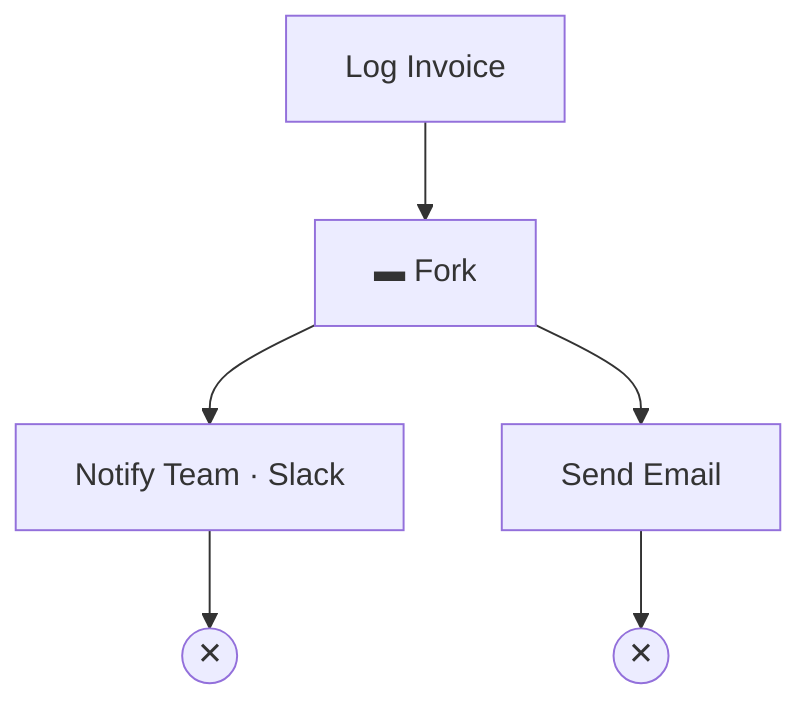
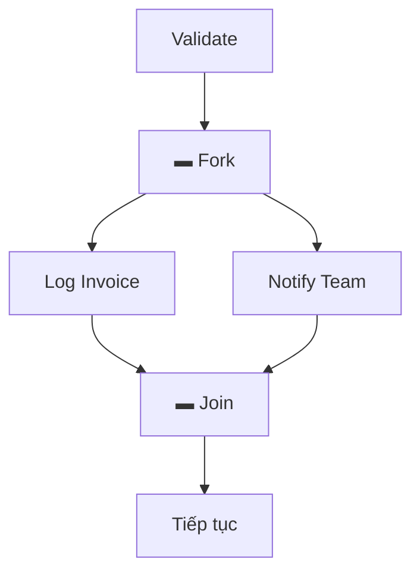
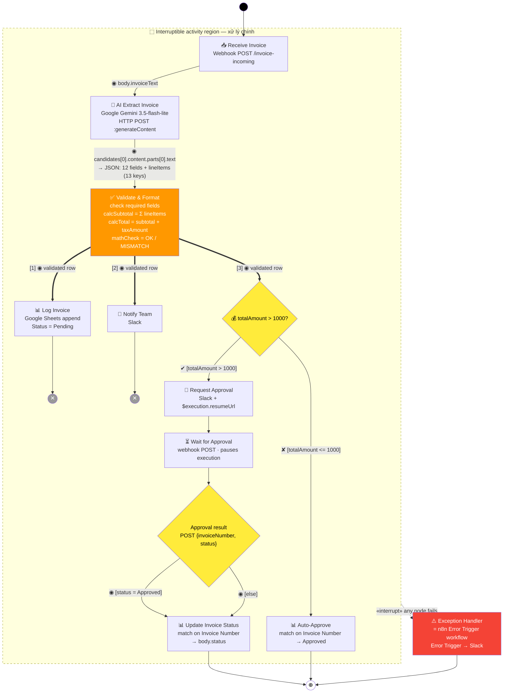
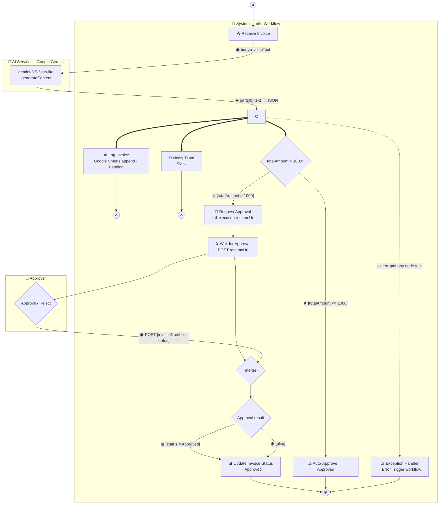

# Invoice Processing Automated — UML Activity Diagram

**Workflow ID:** `InfDUsLVIxCSqqlg` · **n8n:** http://127.0.0.1:5678

## Notation (OMG UML 2.5.1 / uml-diagrams.org)

| Ký hiệu | Hình | Ý nghĩa |
|---|---|---|
| Initial node | ● (black circle) | Bắt đầu workflow |
| **ActivityFinalNode** | ⊕ (encircled) | Kết thúc **toàn bộ** activity — hủy mọi token |
| **FlowFinalNode** | ✕ (circle with X) | Kết thúc **riêng nhánh đó** — token vô hiệu, các nhánh khác tiếp tục |
| Action | rounded rectangle (stadium) | Một bước xử lý |
| Decision node | ◇ diamond | Rẽ nhánh |
| **Guard** | `[condition]` trên **edge** | Điều kiện để đi qua edge (evaluated at runtime). **Mọi edge rời decision node đều phải có guard** |
| Merge node | ◇ diamond | Gộp các nhánh lại |
| Fork / Join | ▬ thick bar | Chia/tổng hợp luồng đồng thời |
| **Fan-out (implicit fork)** | ==> thick arrow | 1 action sinh nhiều token, mỗi outgoing edge nhận 1 token — không cần ForkNode |
| Swimlane (partition) | 2 đường song song + name box | Phân quyền trách nhiệm (organizational unit / actor) |
| Control flow | → open arrowhead | Thứ tự thực hiện (control token) |
| Object flow | → arrow + `◉ data` | Dữ liệu (data token) giữa các action |
| **Exception flow** | ⤏ dashed arrow + `«exception»` | Luồng ngoại lệ khi action thất bại (throw) |
| **Interruptible activity region** | vùng viền đứt nét | Nhóm các action — khi có exception, mọi token trong vùng bị hủy và chuyển sang exception handler |
| Connector | ● nhỏ có tên | Nối 2 edge xa (tránh đường dài) |
| Weight | `{n}` trên edge | Số token tối thiểu đi qua edge |

> **Lưu ý quan trọng (UML 2.5):** guard nằm trên **edge** (mũi tên), không phải trên decision node. Decision node chỉ rẽ nhánh; mỗi edge ra có 1 guard `[condition]` được đánh giá tại runtime. Nếu cặp guard **exhaustive** thì viết phủ định đầy đủ (`[totalAmount <= 1000]`); nếu **không exhaustive** thì dùng guard đặc biệt `[else]` — UML 2.5.1 §12.3.22 cho phép **tối đa 1** outgoing edge của decision node dùng `[else]`, chỉ đúng khi token không được edge nào khác nhận.
> **ActivityFinalNode (⊕) vs FlowFinalNode (✕):** ⊕ kết thúc toàn bộ activity (hủy mọi token đang chạy); ✕ chỉ kết thúc 1 nhánh riêng lẻ. Nhánh `Log Invoice` / `Notify Team` không đi tiếp nên dùng **✕**.

## Activity Diagram vs Flowchart (theo Tutorialspoint)

Activity diagram **không phải là flowchart** — có thêm các khả năng mà flowchart thiếu:

- **Branching** (rẽ nhánh) — decision node + guards
- **Parallel flow** (luồng đồng thời) — fork/join (thick bar)
- **Swimlane** (partition) — phân quyền trách nhiệm
- **Object flow** — dữ liệu chạy giữa các action
- **Exception handling** (xử lý ngoại lệ) — exception flow + interruptible activity region

Activity diagram mô hình **business process** (dùng cho business users), không phải implementation chi tiết. Elements: Activities, Association, Conditions, Constraints.

## Fork / Join (parallel flow) — khi nào dùng

Workflow dùng **fan-out** ở `Validate & Format` (implicit fork — 1 action sinh nhiều token ra 3 nhánh). Fork/Join chặt chẽ (thick bar) dùng khi cần **tổng hợp lại** (join) sau khi các nhánh song song xong; ở đây 2 nhánh kết thúc bằng **FlowFinalNode** nên không cần join:



Ví dụ khi **có** join (các nhánh phải xong hết mới tiếp tục):



## Exception handling (UML 2.5)

2 cách mô hình exception trong activity diagram:

1. **Exception flow** (đơn giản): mũi tên đứt nét `«exception»` từ action throw sang exception handler. Dùng khi 1 action cụ thể có thể fail (ví dụ chỉ Validate & Format throw khi thiếu field).
2. **Interruptible activity region** (chặt chẽ): bao bọc nhóm action trong vùng viền đứt nét. Khi exception xảy ra ở đâu trong vùng, **mọi token đang chạy trong vùng đều bị hủy** và luồng chuyển sang handler. Dùng khi muốn hủy toàn bộ processing khi có lỗi ở bất kỳ node nào.

**Workflow này dùng cách 2** (interruptible activity region bao quanh toàn bộ processing chính), exception flow từ region sang Exception Handler — khớp với n8n Error Trigger (bắt lỗi từ mọi node trong workflow, đã link qua `settings.errorWorkflow`).

## Activity Diagram (có object flow + exception flow)



**Chú thích:**
- Edge label `◉ data` = object flow (data token) — dữ liệu chạy giữa các action.
- Edge label `[condition]` = guard (trên edge, evaluated at runtime). Quy ước: node `F` dùng cặp guard **exhaustive** (`>` và `<=`) nên viết phủ định đầy đủ; node `M` dùng `[status = Approved]` + `[else]` vì giá trị `status` không exhaustive (có thể là chuỗi bất kỳ) — `[else]` đảm bảo token luôn đi đến final node, khớp implementation (node Update nhận mọi giá trị status).
- **Validate & Format fan-out (`==>`, implicit fork):** 1 action sinh nhiều token ra 3 nhánh. `Log Invoice` → **FlowFinalNode ✕**, `Notify Team` → **FlowFinalNode ✕** (cả 2 terminal, token vô hiệu, không chặn nhánh khác); `High Value?` tiếp tục điều hướng. n8n thực thi **tuần tự** đúng thứ tự [1] → [2] → [3].
- **Lý do fan-out:** `Log Invoice` (Sheets append) và `Notify Team` (Slack) đều trả về **API response**, thay thế data chain. Nếu nối tiếp tuyến tính (Log → Notify → High Value?), node sau nhận undefined → rẽ sai nhánh + message thiếu dữ liệu.
- **1 action `Update Invoice Status`, 2 incoming guarded edge:** implementation chỉ có 1 node n8n và **không có decision** sau Wait — node nhận mọi giá trị `$json.body.status`. Mô hình hóa outcome thành decision với `[status = Approved]` + `[else]` là trừu tưởng business process (Approved được ghi rõ, cần lưu ý mọi giá trị khác đều đi qua).
- **Interruptible activity region** (vùng viền đứt nét): bao quanh toàn bộ processing chính. Khi **bất kỳ node nào** trong vùng fail (AI Extract lỗi, Validate throw, Sheets/Slack lỗi...), mọi token trong vùng bị hủy và luồng chuyển sang Exception Handler — khớp với cách n8n Error Trigger hoạt động (bắt lỗi từ mọi node).
- Edge đứt nét `«interrupt»` = interrupt flow (exception flow) từ region sang handler.
- **Wait for Approval** (`resume: webhook`, `httpMethod: POST`): execution tạm dừng. Approver POST `{"invoiceNumber": "...", "status": "Approved"}` vào `$execution.resumeUrl`. Sau resume, node tiếp theo nhận dữ liệu **nested trong `body`** → expression dùng `$json.body.X || $json.X`.
- Validate & Format throw khi thiếu field bắt buộc (`vendor`, `invoiceNumber`, `totalAmount`) là 1 ví dụ cụ thể của exception trong vùng.
- `mathCheck = MISMATCH` **không rẽ nhánh** — vẫn ghi Sheets với flag Math Check = MISMATCH, status = Pending (cần review thủ công).

> **Trạng thái triển khai (n8n):** exception path **đã implement & đã verify end-to-end** (2026-10-10) — workflow `Invoice Error Handler` (Error Trigger → Slack `#all-n8nreceipt`) active, link qua `settings.errorWorkflow`. Test: POST invoice thiếu required fields → main exec 25 **error** tại `Validate & Format` → error workflow exec 26 **tự động trigger** → Slack nhận message (`ok: true`) chứa workflow name/ID, failed node, error message, execution URL.

## Activity — parameters & conditions (UML 2.5, optional)

Activity "Invoice Processing" có thể khai báo:

- **Parameters:** `invoiceText: String` (in). Activity **không có output parameter** — kết quả là **side effect** (Sheets row + Slack message), không trả giá trị về caller (webhook đã response ngay với `responseMode: onReceived`).
- **«precondition»:** invoice received via webhook
- **«postcondition»** (chỉ được assert khi activity hoàn thành): invoice logged to Google Sheets & status set (Pending / Approved / Rejected). Path exception không set status — row giữa giá trị cũ.

## Activity Diagram — Swimlane version (partition)



> Swimlane trong UML là 2 đường song song + name box; Mermaid `subgraph` là xấp xỉ gần đúng. `AI Service (Google Gemini)` và `Approver` là **external participants** nên phải là partition riêng, không nằm trong swimlane System (n8n chỉ gọi qua HTTP API). Exception Handler nằm trong swimlane System (cùng trách nhiệm với workflow). Nhánh approval ở swimlane có 2 cạnh vào (từ `H` và `AP`), vi phạm constraint [1] của UML 2.5.1 §12.3.22 (*a decision node has one incoming edge*) — nên tách thành `«merge»` (MG) → decision `Approval result` (MD) để tuân thủ (diagram chính chỉ có 1 cạnh vào nên không cần merge). Lưu ý: swimlane này không vẽ interruptible activity region — edge «interrupt» vẽ từ node `C` làm điểm đại diện, nhưng nghĩa là **bất kỳ node nào trong SYS** fail đều trigger (xem diagram chính để biết vùng an toàn đầy đủ).

## Data flow qua các node

| Node | Input | Output |
|---|---|---|
| Webhook | `{ invoiceText, fileName }` (từ client) | nested trong `body`: `body.invoiceText` |
| AI Extract | `body.invoiceText` (expression `$json.body.X \|\| $json.X`) | `candidates[0].content.parts[0].text` → JSON |
| Validate | Gemini JSON | validated row (flat) + `mathCheck` |
| **Log Invoice** | validated row (fan-out [1]) | Sheets API response — row appended, Status = Pending → **FlowFinalNode** |
| **Notify Team** | validated row (fan-out [2]) | Slack API response → **FlowFinalNode** |
| **High Value?** | validated row (fan-out [3]) | true / false branch |
| Request Approval | validated row | Slack API response (message có `resumeUrl`) |
| Wait for Approval | execution paused | dừng, chờ POST vào `$execution.resumeUrl` |
| Update Invoice Status | **`body.invoiceNumber` + `body.status`** (nested sau resume) | Sheets row → Approved / Rejected (match `columns.matchingColumns = ["Invoice Number"]`) |
| Auto-Approve | validated row `$json.invoiceNumber` | Sheets row → Approved (match Invoice Number) |
| **Exception Handler** *(workflow riêng: Invoice Error Handler)* | exception (bất kỳ node fail) | Slack `#all-n8nreceipt` (workflow name/ID, failed node, error message, execution URL) |

## Kiểm tra toán học (node Validate & Format)

```
Line items:           7400 + 12000 + 3000 + 4320 + 2500
                          ↓
calcSubtotal =                    29,220.00
calcTotal = 29,220.00 + 2,483.70 = 31,703.70
                          ↓
so sánh calcTotal vs totalAmount (31,703.70)
                          ↓
|31,703.70 − 31,703.70| = 0 < 0.05  →  mathCheck = OK ✅
(nếu AI đọc sai → MISMATCH → flag review thủ công)
```
