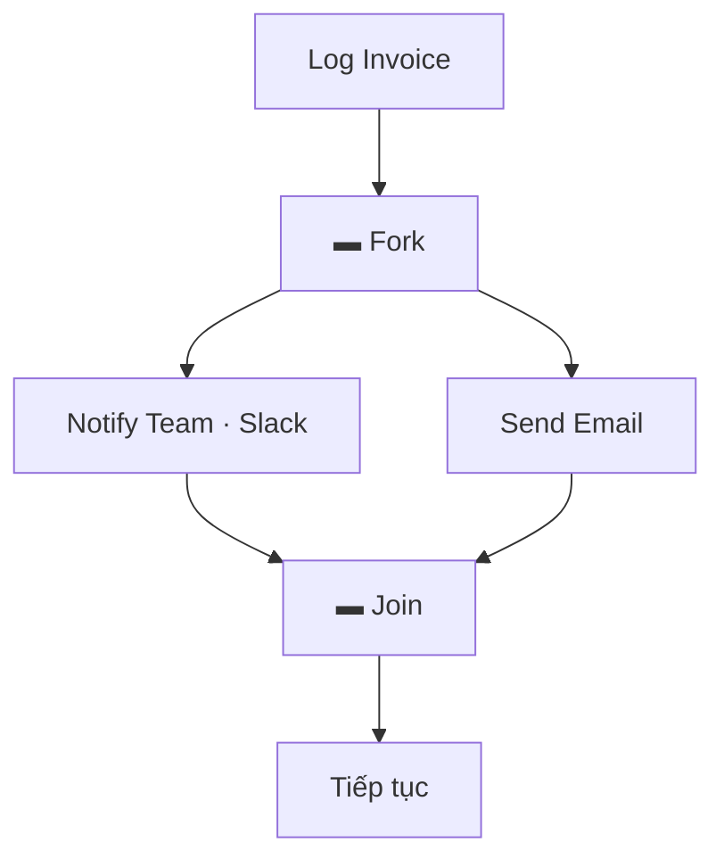
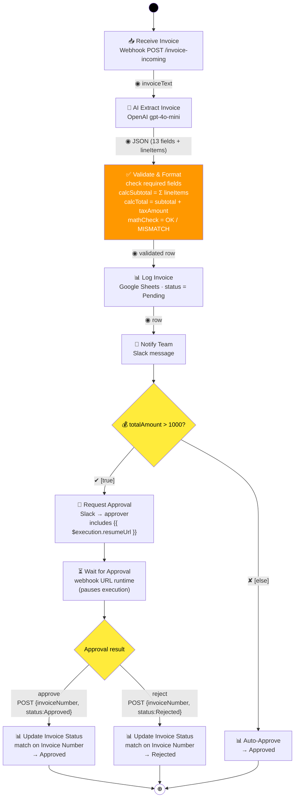
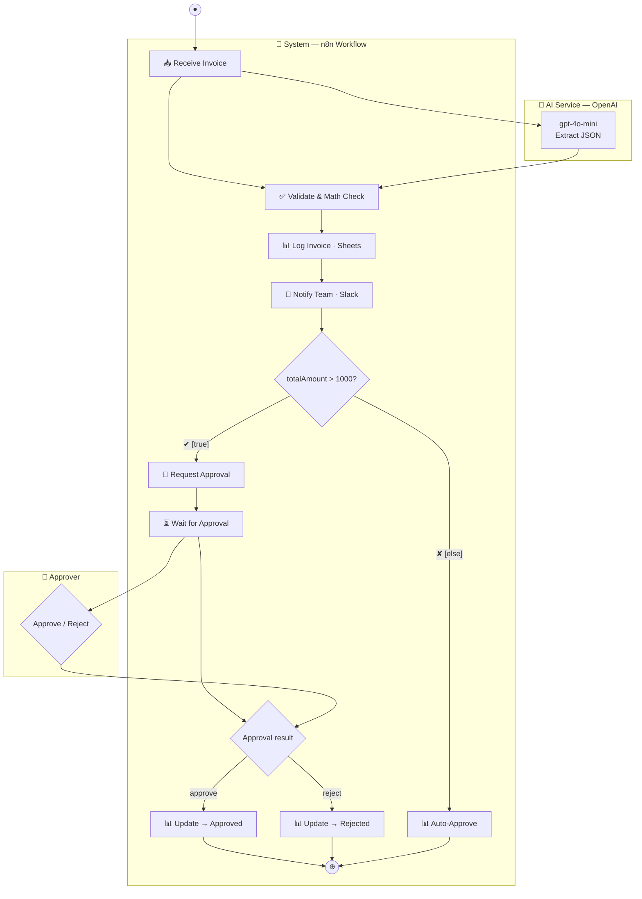

# Invoice Processing Automated — UML Activity Diagram

**Workflow ID:** `InfDUsLVIxCSqqlg` · **n8n:** http://127.0.0.1:5678

## Notation (OMG UML 2.5.1 / uml-diagrams.org)

| Ký hiệu | Hình | Ý nghĩa |
|---|---|---|
| Initial node | ● (black circle) | Bắt đầu workflow |
| Final node | ⊕ (encircled circle) | Kết thúc workflow |
| Action | rounded rectangle (stadium) | Một bước xử lý |
| Decision node | ◇ diamond | Rẽ nhánh |
| **Guard** | `[condition]` trên **edge** | Điều kiện để đi qua edge (evaluated at runtime) |
| Merge node | ◇ diamond | Gộp các nhánh lại |
| Fork / Join | ▬ thick bar | Chia/tổng hợp luồng đồng thời |
| Swimlane (partition) | 2 đường song song + name box | Phân quyền trách nhiệm (organizational unit / actor) |
| Control flow | → open arrowhead | Thứ tự thực hiện (control token) |
| Object flow | → arrow + `◉ data` | Dữ liệu (data token) giữa các action |
| Connector | ● nhỏ có tên | Nối 2 edge xa (tránh đường dài) |
| Weight | `{n}` trên edge | Số token tối thiểu đi qua edge |

> **Lưu ý quan trọng (UML 2.5):** guard nằm trên **edge** (mũi tên), không phải trên decision node. Decision node chỉ rẽ nhánh; mỗi edge ra có 1 guard `[condition]` được đánh giá tại runtime.

## Activity Diagram vs Flowchart (theo Tutorialspoint)

Activity diagram **không phải là flowchart** — có thêm các khả năng mà flowchart thiếu:

- **Branching** (rẽ nhánh) — decision node + guards
- **Parallel flow** (luồng đồng thời) — fork/join (thick bar)
- **Swimlane** (partition) — phân quyền trách nhiệm
- **Object flow** — dữ liệu chạy giữa các action

Activity diagram mô hình **business process** (dùng cho business users), không phải implementation chi tiết. Elements: Activities, Association, Conditions, Constraints.

## Fork / Join (parallel flow) — khi nào dùng

Workflow hiện tại là **sequential** (không có hoạt động đồng thời). Fork/Join dùng khi có hoạt động song song, ví dụ Log Invoice và Send Email chạy đồng thời:



## Activity Diagram (có object flow)



**Chú thích:** edge label `◉ data` = object flow (data token) — dữ liệu chạy giữa các action. Edge label `[condition]` = guard.

## Activity — parameters & conditions (UML 2.5, optional)

Activity "Invoice Processing" có thể khai báo:

- **Parameters:** `invoiceText: String` (in), `status: String` (out)
- **«precondition»:** invoice received via webhook
- **«postcondition»:** invoice logged to Google Sheets & status set (Pending / Approved / Rejected)

## Activity Diagram — Swimlane version (partition)



> Swimlane trong UML là 2 đường song song + name box; Mermaid `subgraph` là xấp xỉ gần đúng.

## Data flow qua các node

| Node | Input | Output |
|---|---|---|
| Webhook | `{ invoiceText, fileName }` | raw invoice text |
| AI Extract | invoice text | structured JSON (13 fields + lineItems) |
| Validate | AI JSON | validated row + `mathCheck` |
| Log Invoice | validated row | Google Sheets row (14 cột, Pending) |
| Notify | row | Slack message |
| High Value? | `totalAmount` | true / false branch |
| Wait | approval webhook (`{{ $execution.resumeUrl }}`) | `{ invoiceNumber, status }` |
| Update Status | approval result | Sheets row → Approved / Rejected (matched by Invoice Number) |

## Kiểm tra toán học (node Validate & Format)

```
Line items:           7400 + 12000 + 3000 + 4320 + 2500
                          ↓
calcSubtotal =                    29,220.00
calcTotal = 29,220.00 + 2,483.70 = 31,703.70
                          ↓
so sánh calcTotal vs totalAmount (31,703.70)
                          ↓
|31,703.70 − 31,703.70| = 0 < 0.05  →  mathCheck = OK ✅
(nếu AI đọc sai → MISMATCH → flag review thủ công)
```
