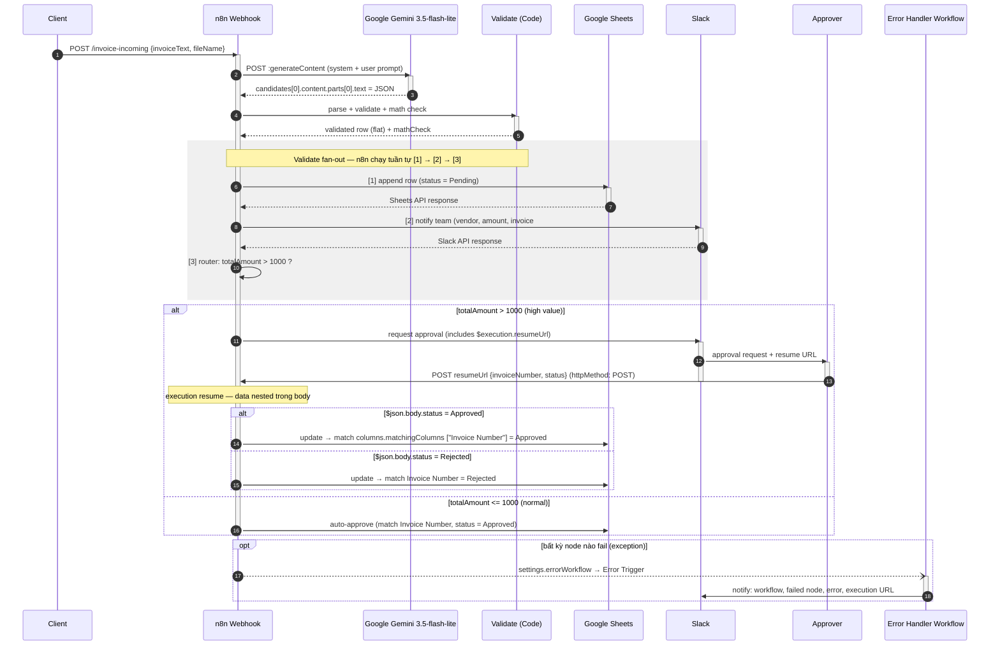

# Invoice Processing Automated — UML Sequence Diagram

**Workflow ID:** `InfDUsLVIxCSqqlg`

Mô tả tương tác giữa các thành phần theo thời gian: Client → n8n Webhook → Google Gemini → Validate → (Google Sheets | Slack | Router) → Approver.

## Ký hiệu

| Ký hiệu | Ý nghĩa |
|---|---|
| `->>` (solid arrow) | Call message (đồng bộ) |
| `-->>` (dashed arrow) | Return message (trả về) |
| `--)` (dashed open) | Asynchronous message (fire-and-forget) |
| `activate / deactivate` | Activation bar (lifeline đang xử lý) |
| `alt / else / end` | Combined fragment — lựa chọn |
| `opt / end` | Combined fragment — tùy chọn |
| `rect rgb(...)` | Vùng tô nền (nhóm message) |
| `autonumber` | Tự động đánh số thứ tự message |

## Ghi chú

- **Validate fan-out:** `Validate & Format` sinh nhiều token ra 3 nhánh ([1] Sheets append, [2] Slack notify, [3] router). Nguyên nhân: node Sheets/Slack trả về **API response** thay thế data chain — nếu nối tiếp tuyến tính, node sau nhận `undefined` → rẽ sai nhánh + message thiếu dữ liệu. n8n thực thi tuần tự theo thứ tự khai báo.
- **Data nesting (webhook):** n8n Webhook node output lồng payload trong `body` → expression dùng `$json.body.invoiceText || $json.invoiceText`.
- **Wait for Approval** (`resume: webhook`, `httpMethod: POST`): execution tạm dừng, `$execution.resumeUrl` sinh tại runtime. Approver POST `{"invoiceNumber": "...", "status": "Approved"}`. Nếu không set `httpMethod: POST` → mặc định GET → resume bị 404 "no waiting webhook with a matching path/method".
- **Sau resume**, dữ liệu đầu vào node tiếp theo cũng nested trong `body` → `Update Invoice Status` dùng `$json.body.invoiceNumber || $json.invoiceNumber`, và `columns.matchingColumns: ["Invoice Number"]` để tìm row.
- **Exception path** (đã implement): `settings.errorWorkflow` → workflow `Invoice Error Handler` (Error Trigger → Slack). Chỉ chạy cho **production executions**; trigger khi bất kỳ node nào fail. Đã verify.
- `mathCheck = MISMATCH` khi `|calcTotal − totalAmount| ≥ 0.05` → không rẽ nhánh, vẫn ghi Sheets kèm flag (cần review thủ công).
- **Alternative:** thay Request Approval + Wait bằng Slack node operation `sendAndWait` (Send and Wait for Response) — approver bấm button trong Slack, response tự động flow qua. Cần Slack OAuth2 có bật interactivity.
