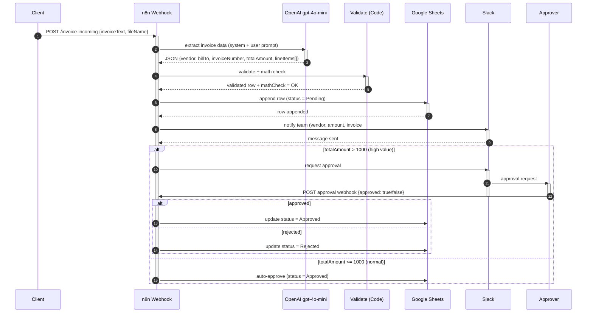

# Invoice Processing Automated — UML Sequence Diagram

**Workflow ID:** `InfDUsLVIxCSqqlg`

Mô tả tương tác giữa các thành phần theo thời gian: Client → n8n Webhook → OpenAI → Validate → Google Sheets → Slack → Approver.

## Ký hiệu

| Ký hiệu | Ý nghĩa |
|---|---|
| `->>` (solid arrow) | Call message (đồng bộ) |
| `-->>` (dashed arrow) | Return message (trả về) |
| `activate / deactivate` | Activation bar (lifeline đang xử lý) |
| `alt / else / end` | Combined fragment — lựa chọn |
| `autonumber` | Tự động đánh số thứ tự message |

## Ghi chú

- **Wait for Approval** node sinh webhook URL tại runtime → Approver POST `{approved: bool}` vào URL đó.
- Nếu AI extraction thất bại hoặc Validate thiếu field bắt buộc → workflow error (có thể route sang error workflow).
- `mathCheck = MISMATCH` khi `|calcTotal − totalAmount| ≥ 0.05` → flag hóa đơn cần review thủ công.
- Có thể thêm combined fragment `opt` (tùy chọn), `loop` (lặp), `par` (đồng thời) nếu cần.
