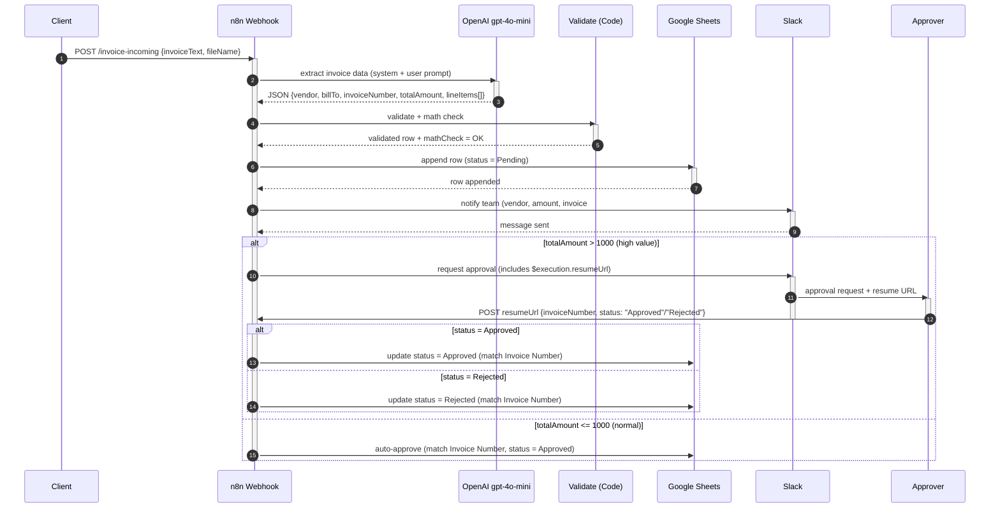

# Invoice Processing Automated — UML Sequence Diagram

**Workflow ID:** `InfDUsLVIxCSqqlg`

Mô tả tương tác giữa các thành phần theo thời gian: Client → n8n Webhook → OpenAI → Validate → Google Sheets → Slack → Approver.

## Ký hiệu

| Ký hiệu | Ý nghĩa |
|---|---|
| `->>` (solid arrow) | Call message (đồng bộ) |
| `-->>` (dashed arrow) | Return message (trả về) |
| `activate / deactivate` | Activation bar (lifeline đang xử lý) |
| `alt / else / end` | Combined fragment — lựa chọn |
| `autonumber` | Tự động đánh số thứ tự message |

## Ghi chú

- **Wait for Approval** node sinh webhook URL tại runtime (`{{ $execution.resumeUrl }}`) → Approver POST `{invoiceNumber, status}` vào URL đó. Execution tạm dừng cho đến khi có request.
- Sau khi resume, dữ liệu đầu vào của node tiếp theo = payload approver POST → **Update Invoice Status** dùng `columns.matchingColumns: ["Invoice Number"]` để tìm row và cập nhật Status.
- Nếu AI extraction thất bại hoặc Validate thiếu field bắt buộc → workflow error (có thể route sang error workflow).
- `mathCheck = MISMATCH` khi `|calcTotal − totalAmount| ≥ 0.05` → flag hóa đơn cần review thủ công.
- Có thể thêm combined fragment `opt` (tùy chọn), `loop` (lặp), `par` (đồng thời) nếu cần.
- **Alternative:** thay Request Approval + Wait bằng Slack node operation `sendAndWait` (Send and Wait for Response) — approver bấm button trong Slack, response tự động flow qua. Cần Slack OAuth2 có bật interactivity.
