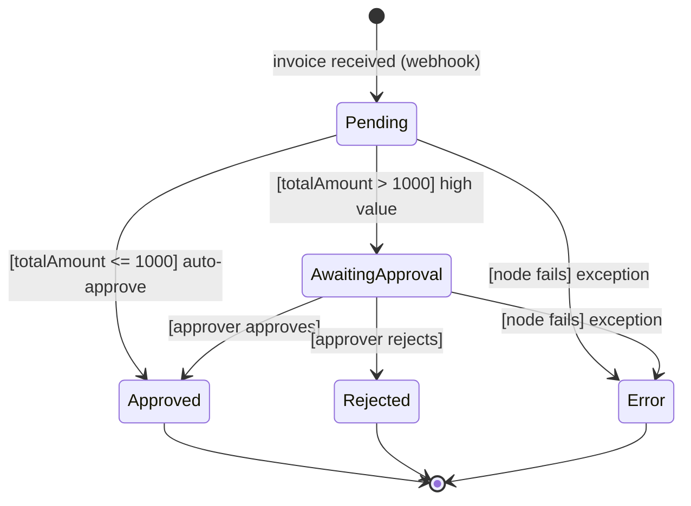

# Invoice Processing Automated — UML State Machine Diagram

**Workflow ID:** `InfDUsLVIxCSqqlg`

Mô tả trạng thái của một hóa đơn qua vòng đời xử lý.

## Ký hiệu

| Ký hiệu | Ý nghĩa |
|---|---|
| `[*]` | Initial / Final (pseudostate) |
| Rounded rectangle | State (trạng thái) |
| `-->` | Transition (chuyển trạng thái) |
| `[condition]` | Guard — điều kiện để chuyển (evaluated at runtime) |
| `trigger: [guard] / action` | Trigger + guard + action trên transition |

## Trạng thái

| Trạng thái | Ý nghĩa |
|---|---|
| Pending | Hóa đơn đã nhận, đang xử lý / chờ duyệt |
| AwaitingApproval | Hóa đơn giá trị cao (>1000), chờ approver duyệt |
| Approved | Đã duyệt (tự động hoặc thủ công) |
| Rejected | Bị từ chối |
| Error | Bất kỳ node nào fail → execution lỗi, trigger Error Handler |

## Chuyển trạng thái (trigger → guard)

| Từ → Đến | Trigger | Guard | Node thực hiện |
|---|---|---|---|
| → Pending | invoice received | — | Invoice Webhook + Log Invoice |
| Pending → AwaitingApproval | evaluated | `[totalAmount > 1000]` | High Value? (IF) |
| Pending → Approved | evaluated | `[totalAmount <= 1000]` | Auto-Approve |
| AwaitingApproval → Approved | approver action | `[approver approves]` | Wait + Update Invoice Status |
| AwaitingApproval → Rejected | approver action | `[approver rejects]` | Wait + Update Invoice Status |
| Pending / AwaitingApproval → Error | node exception | `[any node fails]` | Error Handler Workflow (Error Trigger → Slack) |

## Lưu ý

- Trạng thái được lưu trong cột **Status** của Google Sheets.
- Trạng thái **Error** là trạng thái *execution*, không ghi ngược vào cột Status của sheet (row vẫn giữ giá trị cũ, ví dụ `Pending`). Error Handler chỉ notify Slack (workflow, failed node, error, execution URL).
- Trigger Error chỉ chạy cho **production executions** (không chạy khi manual/test), link qua `settings.errorWorkflow` — đã verify.
- `mathCheck = MISMATCH` không đổi trạng thái mà flag hóa đơn cần review (có thể mở rộng thành trạng thái `Review`).
- UML state diagram còn hỗ trợ **entry/exit actions** (hành động khi vào/ra trạng thái) và **do activities** (hoạt động trong trạng thái) — có thể bổ sung nếu cần.
